# Especificación de Diseño UX/UI: Destinatarios de Avisos como Listas de Emails

> **Módulo:** Configuración de la Sucursal & Compras y Abastecimiento  
> **Slug de trabajo:** `destinatarios-avisos-emails`  
> **Responsable:** Diseñador UX/UI COTO Backoffice  
> **Fecha:** 3 de noviembre de 2026  
> **Estado:** Aprobado para implementación  

---

## 1. Resumen y Objetivos de Diseño

El sistema actual acoplaba la definición de parámetros de reabastecimiento con la elección de un contacto y canal particular por cada artículo en el modal de Compras. Esta arquitectura generaba sobrecarga operativa para los operadores de compras y sucursal, riesgo de avisos desactualizados o perdidos y rigidez ante cambios de personal en los sectores.

El rediseño desacopla estas responsabilidades en base a tres pilares:
1. **Centralización en Configuración:** Una nueva solapa **"Destinatarios de avisos"** (`#/configuracion/destinatarios`) para administrar la lista general de correos de la sucursal y listas especializadas por categoría de producto.
2. **Simplificación en Compras:** El modal de **"Política de reposición"** se enfoca exclusivamente en reglas de stock (tipo, umbrales y stock objetivo), eliminando los selectores de contacto y canal, e informando con transparencia a qué correos se despacharán los avisos según la jerarquía del artículo.
3. **Visibilidad inmediata en la grilla:** La columna **"Avisar a"** de la tabla de políticas de Compras refleja el origen y conteo de destinatarios resueltos (ej. `3 emails (Categoría: Lácteos)` o `2 emails (Lista general)`), alertando si un artículo queda sin destinatarios configurados.

Todo el diseño sigue de manera irrestricta los fundamentos del **Design System COTO** (Gotham Rounded / Nunito, tokens semánticos, ritmo de 8 puntos, proporción 60/30/10 y accesibilidad WCAG AA).

---

## 2. Flujos de Usuario

```mermaid
flowchart TD
    subgraph Configuración ["Configuración → Destinatarios de avisos"]
        A["Operador ingresa a Configuración"] --> B{"¿Qué desea configurar?"}
        B -->|Lista general| C["Ingresar nuevo email en lista general"]
        C --> D{"¿Formato y unicidad válidos?"}
        D -->|No| E["Mostrar error inline accionable"]
        D -->|Sí| F["Agregar chip de email a la lista"]
        F --> G["Click en 'Guardar lista general'"]
        G --> H["API PUT /general + Toast éxito"]

        B -->|Lista por categoría| I["Seleccionar/Expandir categoría"]
        I --> J{"¿Tiene emails configurados?"}
        J -->|No| K["Muestra estado: Hereda de lista general"]
        J -->|Sí| L["Muestra chips de emails propios"]
        K --> M["Ingresar nuevo email específico"]
        L --> M
        M --> N{"¿Válido y único?"}
        N -->|No| E2["Mostrar error inline"]
        N -->|Sí| O["Agregar chip a categoría"]
        O --> P["Click en 'Guardar categoría'"]
        P --> Q["API PUT /categorias/{id} + Toast éxito"]
        L --> R["Click en 'Restablecer a lista general'"]
        R --> S["Confirmar descarte + API PUT vacío"]
    end

    subgraph Compras ["Compras → Reposición"]
        T["Operador abre modal 'Política de reposición'"]
        T --> U["Modificar tipo, umbrales y objetivo"]
        U --> V["Visualizar bloque informativo de resolución de emails"]
        V --> W["Guardar política"]
        W --> X["Tabla de políticas actualiza columna 'Avisar a'"]
    end
```



### Flujo 1: Gestión de la lista general de emails de la sucursal
1. El operador navega a **Configuración** (`#/configuracion/destinatarios`).
2. Visualiza la tarjeta **"Lista general de la sucursal"** con el total de emails activos en un badge (ej. `2 emails`) y los chips correspondientes.
3. **Agregar email:**
   - Escribe una dirección en el campo *Nuevo correo electrónico*.
   - Presiona `Enter` o clickea el botón **"Agregar correo"** (`Button variant="secondary" size="md"`).
   - El sistema valida el formato de email (`^[^@\s]+@[^@\s]+\.[^@\s]+$`) y que no exista previamente en la lista (case-insensitive).
   - Si no es válido o está repetido, se despliega un error inline sin limpiar el campo para permitir corrección rápida.
   - Si es válido, se inserta inmediatamente el chip visual en la lista, se limpia el campo y se marca el panel como *Sin guardar* (`Badge tone="warning"`).
4. **Eliminar email:**
   - Clickea el botón `X` del chip deseado.
   - El chip desaparece de la vista y se activa el estado *Sin guardar*.
5. **Persistir:**
   - Clickea **"Guardar lista general"** (`Button variant="primary"`).
   - Se bloquea la interfaz durante la petición (`busy`).
   - Al completarse con éxito: Toast verde *"Lista general guardada. Los próximos avisos usarán estas direcciones."* y Badge pasa a *Guardado* (`tone="success"`).
6. **Cancelar / Descartar:** Si el operador intenta salir con cambios pendientes o presiona **"Descartar cambios"**, se restablece el estado al último confirmado por la API.

### Flujo 2: Gestión de listas de emails por categoría
1. En la sección **"Listas por categoría"**, el operador visualiza el acordeón/listado con todas las categorías activas de la sucursal.
2. Cada fila o tarjeta muestra:
   - Nombre de la categoría.
   - Cantidad de artículos clasificados (ej. `14 artículos`).
   - Estado de resolución:
     - `Badge tone="success"`: `3 emails propios` (si definió lista específica).
     - `Badge tone="neutral"`: `Hereda lista general (2 emails)` (si no tiene correos específicos).
     - `Badge tone="warning"`: `Sin destinatarios` (si no tiene específicos y la general está vacía).
3. **Expandir y configurar:**
   - El operador abre la categoría (ej. *Lácteos*).
   - Se despliega el panel de edición con su lista actual de chips.
   - Si hereda de la general, se muestra un mensaje informativo sutil (`.form-info`): *"Esta categoría utiliza los 2 correos de la lista general de la sucursal. Podés cargar direcciones específicas para que las alertas de Lácteos vayan exclusivamente a este equipo."*
4. **Agregar/Eliminar correos de categoría:**
   - Idéntica validación que en la lista general.
   - Al ingresar el primer correo propio, la categoría pasa automáticamente a modo *Específico*.
5. **Guardar categoría:**
   - Botón **"Guardar categoría"** (`Button variant="primary"`).
   - Llama a `PUT /api/configuracion/destinatarios/categorias/{id}`.
   - Toast de confirmación: *"Destinatarios de la categoría Lácteos guardados."*
6. **Restablecer herencia (volver a lista general):**
   - Si la categoría tiene correos propios y el operador desea que vuelva a heredar de la sucursal, hace click en **"Restablecer a lista general"** (`Button variant="ghost"` con ícono `RotateCcw`).
   - El sistema limpia los chips propios, muestra el aviso de herencia y guarda la lista vacía para la categoría.

### Flujo 3: Configuración simplificada de Política de Reposición en Compras
1. En **Compras → Reposición**, el operador hace click en **"Configurar"** sobre un artículo simple.
2. Se abre el modal **"Política de reposición"**.
3. **Lo que ve el operador:**
   - Encabezado con nombre del artículo, SKU y tipo.
   - Selector de tipo de política: *Punto de pedido*, *Por demanda* o *Estacional*.
   - Campos numéricos correspondientes al tipo elegido.
   - Divisor visual (`.form-divider`).
   - Campo **"Umbral de alerta"** (unidades mínimas que disparan la notificación).
   - **Caja de resolución de destinatarios** (`.notice-resolution-card`):
     - Muestra claramente cómo se resolverá la notificación si el stock cae por debajo del umbral:
       - *Caso 1 (con categoría y correos propios):* Ícono `Mail` + *"Avisos por email: se enviarán a los **3 destinatarios de la categoría Lácteos** (compras.lacteos@coto.com.ar, repo.frescos@coto.com.ar...)."*
       - *Caso 2 (con categoría que hereda general):* Ícono `Mail` + *"Avisos por email: la categoría Bebidas no tiene correos propios. Se enviarán a los **2 destinatarios de la lista general**."*
       - *Caso 3 (artículo sin categoría):* Ícono `Mail` + *"Avisos por email: el artículo no tiene categoría asignada. Se enviarán a los **2 destinatarios de la lista general**."*
       - *Caso 4 (sin correos en categoría ni en general):* Ícono `AlertCircle` + Badge warning: *"Atención: no hay destinatarios configurados en la categoría ni en la sucursal. El sistema registrará el stock bajo pero no se emitirán avisos."*
     - Enlace directo: `"Administrar destinatarios en Configuración"` (`href="#/configuracion/destinatarios"`).
4. El operador guarda la política con **"Guardar política"** (`Button variant="primary"`).

### Flujo 4: Visualización en la tabla de Compras → Reposición
1. En la tabla de artículos de **Políticas por artículo**, la columna **"Avisar a"** se actualiza para mostrar:
   - Si no tiene política: `—` (caption gris).
   - Si tiene política:
     - Conteo de emails en negrita (`strong`).
     - Origen explícito en segunda línea (`.caption`): `Categoría: [Nombre]` o `Lista general`.
     - Si hay 0 emails resueltos: `<Badge tone="warning">Sin destinatarios</Badge>`.
   - Tooltip (`title`) con el listado completo de correos electrónicos resueltos al pasar el puntero o enfocar con teclado.

---

## 3. Estructura de Pantalla y Jerarquía Tipográfica

### Grilla y Zonas (Desktop 1024 px)
- Margen exterior: 24 px (`--grid-margin`).
- Contenedor principal: Ancho máximo 1660 px con gutters de 16 px (`--grid-gutter`).
- Navegación por solapas en Configuración:
  ```html
  <nav class="tabs" aria-label="Secciones de configuración">
    <a href="#/configuracion/destinatarios" class="active" aria-current="page">Destinatarios de avisos</a>
    <a href="#/configuracion/categorias">Categorías</a>
    <a href="#/configuracion/contactos">Agenda de proveedores</a>
  </nav>
  ```
- Layout en dos zonas para `#/configuracion/destinatarios`:
  - **Zona Principal (arriba o columna izquierda de 645 px):** Panel de **Lista general de la sucursal**.
  - **Zona Secundaria / Inferior (columna derecha de 315 px o bloque full width):** Panel de **Listas por categoría**.
  - En viewport amplio (>1080 px): Disposición vertical en paneles ordenados por jerarquía:
    1. `Panel 1: Lista general de la sucursal` (el fallback universal del sistema).
    2. `Panel 2: Listas específicas por categoría` (la especialización por sector).

### Jerarquía Tipográfica por Elemento

| Elemento | Token de Estilo | Tamaño / Interlínea | Peso | Color Token |
| --- | --- | --- | --- | --- |
| Título de página | `--heading-h1` | 28 px / 1.4 | Semibold (600) | `var(--primary-700)` |
| Eyebrow de página | `--caption` | 12 px / 1.4 | Bold (700) | `var(--neutral-700)` |
| Subtítulo de página | `--body-medium` | 16 px / 1.4 | Regular (400) | `var(--neutral-700)` |
| Títulos de Panel / Card | `--heading-h4` | 20 px / 1.4 | Semibold (600) | `var(--neutral-900)` |
| Descripción de Panel | `--caption` | 12 px / 1.5 | Regular (400) | `var(--neutral-700)` |
| Nombre de Categoría | `--body-large` | 18 px / 1.4 | Semibold (600) | `var(--neutral-900)` |
| Etiquetas de Formulario (`label`) | `--body-medium` | 16 px / 1.4 | Semibold (600) | `var(--neutral-800)` |
| Texto de Input / Select | `--body-medium` | 16 px / 1.4 | Regular (400) | `var(--neutral-900)` |
| Texto de Chip de Email | `--caption` / `--body-medium` | 13 px / 1.2 | Regular (400) | `var(--neutral-900)` |
| Ayudas (`.field-hint`) | `--caption` | 12 px / 1.5 | Regular (400) | `var(--neutral-700)` |
| Mensaje de Información (`.form-info`) | `--caption` | 12 px / 1.6 | Regular (400) | `var(--info-800)` |
| Errores Inline (`.inline-error`) | `--body-medium` | 14 px / 1.4 | Semibold (600) | `var(--danger-800)` |
| Botones primarios y secundarios | `--body-medium` | 16 px / 1.35 | Bold (700) | Blanco / Neutro 800 |
| Botones pequeños (`sm`) | `--caption` | 12 px / 1.35 | Bold (700) | Según variante |

---

## 4. Componentes y Átomos del Design System

### 4.1 Átomos y Componentes Existentes Reutilizados

- **`PageHeading`** (`ui.tsx`):
  - Encabezado canónico con `eyebrow="Configuración"`, `title="Destinatarios de avisos"`.
- **`Panel`** (`.panel`, `.panel-heading`, `.panel-body`):
  - Superficie blanca con borde `var(--neutral-100)` y sombra `--shadow-100`.
- **`Button`** (`ui.tsx`):
  - Variante `primary` (`size="md"` y `size="sm"`): para *"Guardar lista general"*, *"Guardar categoría"*, *"Guardar política"*.
  - Variante `secondary`: para cancelar o descartar.
  - Variante `lineal` o `dark`: para *"Agregar correo"*.
  - Variante `ghost`: para acciones secundarias como *"Restablecer a lista general"*.
- **`IconButton`** (`ui.tsx`):
  - `appearance="naked"` o `lineal` con íconos de `lucide-react` (24 px / 32 px).
- **`Field`** (`ui.tsx`):
  - Envoltorio de input con etiqueta y enlace a `aria-describedby` para hints y errores.
- **`Badge`** (`ui.tsx`):
  - `tone="success"`: `Guardado`, `N emails propios`.
  - `tone="warning"`: `Sin guardar`, `Sin destinatarios`.
  - `tone="neutral"`: `Hereda lista general`.
- **`ErrorMessage`** (`ui.tsx`):
  - Alerta de error de servidor o conexión con ícono `AlertCircle`.
- **`Modal`** (`ui.tsx`):
  - Ventana modal accesible para la política de reposición (`CatalogForms.tsx`).

### 4.2 Nuevo Átomo: Chip de Correo Interactivo (`.email-chip`)

Para la visualización y manipulación ágil de las direcciones de correo, se formaliza el átomo `.email-chip` en el Design System (incorporado a `components.css` y documentado en `docs/design-system/README.md`):

#### Anatomía
- Contenedor en línea con `display: inline-flex; align-items: center; gap: var(--space-1);`
- Altura mínima: 36 px (en desktop) / 40 px en móvil para garantizar touch target.
- Relleno: `var(--neutral-50)`, borde de 1 px en `var(--neutral-200)`, radio `var(--radius-pill)`.
- Padding horizontal: 12 px en la izquierda, 4 px en la derecha (alrededor del botón eliminar).
- Ícono: `Mail` de 16 px en `var(--neutral-700)`.
- Texto del email: `var(--neutral-900)`, peso `--weight-regular`, no deformable (`white-space: nowrap; word-break: break-all;`).
- Botón de remoción: botón circular de 28 px con ícono `X` (14 px), `aria-label="Eliminar correo {email}"`, hover con fondo `var(--danger-100)` y color `var(--danger-800)`.
- Foco accesible: `:focus-within` con halo de 2 px en `var(--info-500)`.

```css
/* Átomo Chip de Email en components.css */
.email-chip-list {
  display: flex;
  flex-wrap: wrap;
  gap: var(--space-1);
  margin-block: var(--space-2);
  min-height: 44px;
  align-items: center;
}

.email-chip {
  display: inline-flex;
  align-items: center;
  gap: var(--space-1);
  min-height: 36px;
  padding: 4px 6px 4px 12px;
  border-radius: var(--radius-pill);
  background: var(--neutral-50);
  border: 1px solid var(--neutral-200);
  font-size: var(--body-medium);
  color: var(--neutral-900);
  transition: background .14s, border-color .14s, box-shadow .14s;
}

.email-chip:hover {
  background: var(--neutral-100);
  border-color: var(--neutral-300);
}

.email-chip-remove {
  display: inline-grid;
  place-items: center;
  width: 28px;
  height: 28px;
  border-radius: var(--radius-pill);
  background: transparent;
  color: var(--neutral-700);
  border: 0;
  cursor: pointer;
  transition: background .12s, color .12s;
}

.email-chip-remove:hover:not(:disabled) {
  background: var(--danger-100);
  color: var(--danger-800);
}

.email-chip-remove:focus-visible {
  outline: 2px solid var(--info-500);
  outline-offset: 1px;
}
```

### 4.3 Componente Compuesto: Tarjeta de Categoría con Herencia (`CategoryNoticeCard`)

Para evitar pantallas complejas o modales anidados, las categorías se gestionan mediante tarjetas con selector o acordeón desplegable:

- **Cabecera de la tarjeta:**
  - Título: Nombre de la categoría (ej. *Lácteos*).
  - Metadato: Cantidad de artículos vinculados (`data.productos.filter(p => p.categoriaId === cat.id).length`).
  - Badge de resolución actual:
    - Si tiene correos propios: `<Badge tone="success">{cat.emails.length} propios</Badge>`
    - Si no tiene propios: `<Badge tone="neutral">Hereda lista general ({general.length})</Badge>`
  - Botón colapsable con chevron (`ChevronDown` / `ChevronUp`).
- **Cuerpo expandido:**
  - Si no tiene propios: banner informativo con opción *"Definir correos propios para esta categoría"*.
  - Formulario de adición rápida (input tipo email + botón *"Agregar"*).
  - Lista de chips de correos propios.
  - Pie de acciones: Botón primario *"Guardar categoría"* + Botón terciario *"Restablecer a lista general"* (si tiene correos propios).

---

## 5. Estados de la Interfaz

### 5.1 Estados de la Lista General

| Estado | Indicador Visual | Comportamiento y Mensaje |
| --- | --- | --- |
| **Normal / Guardado** | Badge verde `Guardado` | Lista sincronizada con el backend. Botón de guardar deshabilitado. |
| **Edición / Sin guardar** | Badge amarillo `Sin guardar` | Hay emails agregados o eliminados localmente. Botón *"Guardar lista general"* activo en rojo COTO (`var(--primary-500)`). |
| **Lista General Vacía** | Alerta en panel con `tone="warning"` | Ícono `AlertCircle` (32 px). *"La sucursal no tiene emails en su lista general. Si un artículo de una categoría sin correos cae bajo umbral, no se enviarán alertas."* |
| **Cargando / Guardando** | Spinner `LoaderCircle` en botón | Botón *"Guardando…"* deshabilitado, inputs bloqueados (`disabled={busy}`). |
| **Error de validación inline** | Mensaje rojo bajo el input | *"Ingresá un correo electrónico válido (ejemplo@coto.com.ar)."* o *"Esta dirección ya está en la lista."* |
| **Error de API** | Banner `ErrorMessage` (`danger`) | Muestra el error arrojado por el backend (ej. 400 formato o 500 servidor) con opción de reintentar. |

### 5.2 Estados de la Lista de una Categoría

| Estado | Indicador Visual | Comportamiento |
| --- | --- | --- |
| **Hereda de General (Default)** | Badge neutral `Hereda lista general (N)` | La categoría no tiene registros en `destinatario_aviso`. Si cae un stock bajo de esta categoría, el gestor de inventario despacha a la lista general de la sucursal. |
| **Especializada (Propios)** | Badge success `N emails propios` | La categoría tiene direcciones específicas. Solo esas direcciones recibirán el aviso. |
| **Sin destinatarios posibles** | Badge warning `Sin destinatarios` | Ocurre si la categoría está en herencia pero la lista general también está vacía (0 emails en total). Se destaca en ámbar en la grilla de reposición. |

---

## 6. Contenido y Microcopy (Español Rioplatense - Voseo)

Siguiendo las pautas del backoffice de COTO, el tono es directo, claro, profesional y en voseo:

### Textos de Navegación y Encabezados
- **Pestaña en Configuración:** `Destinatarios de avisos`
- **Título principal:** `Destinatarios de avisos por correo`
- **Subtítulo principal:** `Configurá a qué correos electrónicos se envían las alertas automáticas cuando el stock disponible cae por debajo del umbral de reposición.`
- **Panel General:** `Lista general de la sucursal`
- **Descripción General:** `Destinatarios predeterminados para todos los artículos que no cuenten con una lista propia en su categoría o que no tengan categoría asignada.`
- **Panel Categorías:** `Listas específicas por categoría`
- **Descripción Categorías:** `Definí destinatarios especializados por sector. Al configurar una categoría, sus artículos dejarán de usar la lista general.`

### Formularios y Acciones (Etiquetas con Verbo)
- **Input general:** `Nuevo correo electrónico` — Placeholder: `ejemplo@coto.com.ar`
- **Botón agregar:** `Agregar dirección`
- **Botón guardar general:** `Guardar lista general`
- **Botón guardar categoría:** `Guardar categoría`
- **Botón restablecer:** `Restablecer a lista general`
- **Botón cancelar modal:** `Cancelar`
- **Botón guardar política:** `Guardar política`
- **Acción tabla Compras:** `Configurar`

### Mensajes de Validación y Error Accionables
- *Formato inválido:* `"Ingresá un correo electrónico con formato válido (ejemplo@coto.com.ar)."`
- *Email duplicado:* `"Esta dirección de correo ya figura en la lista."`
- *Campo vacío al agregar:* `"Escribí una dirección de correo antes de agregarla."`
- *Error de red/API:* `"No pudimos guardar los destinatarios. Verificá la conexión y volvé a intentar."`

### Modal de Reposición (Microcopy Informativo)
- *Título de bloque:* `Destinatarios del aviso automático`
- *Resolución por Categoría:* `"Avisos por email para la categoría **{nombre}**: se enviarán a **{conteo} destinatarios** ({lista_resumida})."`
- *Resolución por General:* `"Avisos por email: la categoría **{nombre}** no tiene lista propia. Se enviarán a los **{conteo} destinatarios de la lista general**."`
- *Sin categoría asignada:* `"Avisos por email: el artículo no tiene categoría asignada. Se enviarán a los **{conteo} destinatarios de la lista general**."`
- *Alerta sin destinatarios:* `"Atención: no hay destinatarios en la categoría ni en la sucursal. Se registrará la alerta pero no se enviarán correos."`
- *Enlace de configuración:* `"Administrar destinatarios en Configuración →"`

---

## 7. Accesibilidad (A11y - WCAG AA)

1. **Ratios de Contraste Verificados:**
   - Texto de chips sobre fondo `--neutral-50`: `#1B171C` sobre `#F3F1F3` → Ratio **15.75:1** (Supera ampliamente AAA).
   - Botón de remoción `X`: color base `#504653` sobre `#F3F1F3` → Ratio **8.96:1**; en hover `#622004` sobre `#FDDCCE` → Ratio **8.8:1**.
   - Botón Primario COTO: `#FFFFFF` sobre `#E2001A` → Ratio **4.94:1** (Cumple AA para texto de 16 px bold).
   - Enlaces y focos: `#284387` sobre `#FFFFFF` → Ratio **7.1:1** (Cumple AAA).
2. **Navegación por Teclado y Foco Visible:**
   - El input de nuevo correo permite presionar `Enter` para agregar el email inmediatamente a la lista de chips, devolviendo el foco al input para carga secuencial rápida.
   - Cada botón de eliminación de chip es alcanzable por `Tab` y activable con `Espacio` o `Enter`.
   - Todos los elementos interactivos tienen anillo de foco visible con token `var(--color-focus)` (`3px solid var(--info-500); outline-offset: 2px`).
3. **Semántica y Atributos ARIA:**
   - La lista de chips se marca semánticamente como lista con `role="list"` y cada chip como `role="listitem"`.
   - Cada botón de eliminación cuenta con `aria-label="Eliminar correo {email} de la lista"`.
   - Los mensajes de error utilizan `role="alert"` y están vinculados al input mediante `aria-describedby` y `aria-invalid="true"`.
   - Los acordeones de categoría cuentan con `aria-expanded="true|false"` y `aria-controls="panel-categoria-{id}"`.
4. **Objetivos Táctiles (Touch Targets):**
   - El botón de eliminar de los chips tiene un área táctil de `min-width: 28px; min-height: 28px` con padding expandido en móvil para garantizar al menos 40 px de interacción efectiva.
   - Los botones de acción de formularios respetan `min-height: 44px`.
5. **No Dependencia Exclusiva del Color:**
   - Los badges combinan color con texto explicativo y punto de estado (`badge-dot`).
   - Las alertas combinan color de fondo con íconos distintivos (`AlertCircle`, `CheckCircle2`, `Mail`).

---

## 8. Diseño Adaptativo (Responsive Design)

### Comportamiento a 1024 px (Desktop Operativo)
- El contenedor de Configuración organiza la **Lista General** en la parte superior ocupando el ancho del panel (`.panel`), con el formulario de adición en una sola fila compacta (input + botón agregar alineados).
- La sección de **Listas por categoría** se despliega abajo, con una grilla de 2 columnas para categorías o un listado vertical de tarjetas compactas.
- En la tabla de Compras → Reposición, la columna *"Avisar a"* dispone de 220 px de ancho de celda, permitiendo visualizar el conteo en negrita y el origen con total legibilidad.

### Comportamiento a 390 px (Móvil / Terminal Táctil de Sucursal)
- Los paneles pasan a ancho completo (`width: 100%`) con márgenes de 16 px.
- El grupo de entrada de email se apila verticalmente: input arriba y botón *"Agregar dirección"* a 100% de ancho abajo.
- Los chips de emails se ajustan con `flex-wrap: wrap; gap: 8px;` y ocupan el ancho necesario sin provocar scroll horizontal.
- En las tarjetas de categorías, los badges de estado se alinean debajo del nombre de la categoría para no apretar la cabecera.
- En el modal de Reposición, la caja de resolución de avisos se ubica antes de los botones de confirmación, y los botones de acción del modal se apilan al 100% de ancho.
- En la tabla de Compras, el scroll horizontal (`.table-scroll`) protege la visualización de la columna de destinatarios sin comprimir los datos.

---

## 9. Contrato de Integración Frontend con Backend

Para asegurar la coherencia entre el diseño y los endpoints definidos en el `plan.md`:

```typescript
// Estructura de respuesta del endpoint GET /api/configuracion/destinatarios
export interface DestinatariosAvisosResponse {
  general: string[]; // Lista de emails de la sucursal (ej. ["sucursal42@coto.com.ar"])
  porCategoria: Record<number, string[]>; // Mapa categoriaId -> lista de emails
}

// DTO para actualización de lista general PUT /api/configuracion/destinatarios/general
export interface ActualizarDestinatariosGeneralRequest {
  emails: string[];
}

// DTO para actualización de categoría PUT /api/configuracion/destinatarios/categorias/{id}
export interface ActualizarDestinatariosCategoriaRequest {
  emails: string[];
}
```

### Función de Resolución en Frontend (`notifications.ts`)
```typescript
export interface DestinatariosResueltos {
  emails: string[];
  origen: 'CATEGORIA' | 'GENERAL' | 'NINGUNO';
  categoriaNombre?: string;
  resumenTexto: string;
}

export function resolverDestinatariosAviso(
  data: Snapshot,
  product: Producto
): DestinatariosResueltos {
  const categoria = data.categorias.find(c => c.id === product.categoriaId);
  const emailsCategoria = categoria && data.destinatarios?.porCategoria?.[categoria.id];

  if (emailsCategoria && emailsCategoria.length > 0) {
    return {
      emails: emailsCategoria,
      origen: 'CATEGORIA',
      categoriaNombre: categoria.nombre,
      resumenTexto: `${emailsCategoria.length} ${emailsCategoria.length === 1 ? 'email' : 'emails'} (Categoría: ${categoria.nombre})`
    };
  }

  const emailsGeneral = data.destinatarios?.general || [];
  if (emailsGeneral.length > 0) {
    return {
      emails: emailsGeneral,
      origen: 'GENERAL',
      categoriaNombre: categoria?.nombre,
      resumenTexto: `${emailsGeneral.length} ${emailsGeneral.length === 1 ? 'email' : 'emails'} (Lista general)`
    };
  }

  return {
    emails: [],
    origen: 'NINGUNO',
    categoriaNombre: categoria?.nombre,
    resumenTexto: 'Sin destinatarios configurados'
  };
}
```

---

## 10. Modificaciones al Design System

Para dar soporte nativo a esta especificación, se incorporan los siguientes ajustes a las hojas de estilo del Design System:

1. **`frontend/src/styles/components.css`**:
   - Inclusión de las clases `.email-chip`, `.email-chip-list`, `.email-chip-remove` y `.email-input-group`.
   - Inclusión de `.notice-resolution-card` para el bloque informativo del modal.
   - Clases puras basadas en tokens (`var(--neutral-...)`, `var(--space-...)`, `var(--radius-...)`).
2. **`docs/design-system/README.md`**:
   - Incorporación de la sección **Chips / Tags de Email** y **Tarjeta de Resolución de Avisos** en el catálogo de átomos.

---

## 11. Auditoría de UI (Modo 2)

> **Fecha de auditoría inicial:** 3 de noviembre de 2026  
> **Fecha de re-auditoría (Vuelta 1 de correcciones):** 3 de noviembre de 2026  
> **Auditor:** Diseñador UX/UI Backoffice COTO  
> **Archivos auditados:** `NoticeRecipients.tsx`, `Settings.tsx`, `CatalogForms.tsx`, `Purchases.tsx`, `components.css`, `tokens.css`, `docs/design-system/README.md`.

---

### Resumen de Re-auditoría (Vuelta 1)

Tras la primera vuelta de correcciones implementadas por el equipo de frontend, se verificaron todos los puntos observados:

| Categoría | Total Inicial | Resueltos | Abiertos (No bloqueantes) |
| --- | :---: | :---: | :---: |
| **Bloqueantes** | 3 | **3** | **0** |
| **Mejoras** | 7 | **4** | **3** |

> [!IMPORTANT]
> **Dictamen: APROBADO SIN BLOQUEANTES.**
> Todos los hallazgos bloqueantes (crash de runtime en `PolicyForm`, omisión de la tarjeta de resolución, adaptabilidad móvil a 390 px y clase faltante `.message.warning`) han sido resueltos satisfactoriamente. Se verificó también la accesibilidad por teclado en la tabla de `Purchases.tsx` y el soporte táctil ≥ 40 px en `.email-chip-remove`.

---

### Estado Detallado de Hallazgos

#### 1. Runtime Crash en modal de Reposición y omisión del rediseño acordado
- **Archivo:** [`frontend/src/components/CatalogForms.tsx`](file:///c:/Users/juanp/sistema-gestion-stock-coto/frontend/src/components/CatalogForms.tsx#L39-L120)
- **Estado:** `RESUELTO`
- **Verificación:**
  - Se eliminó la invocación a `destinoAviso` que provocaba `ReferenceError`.
  - Se eliminaron por completo los selectores y estados obsoletos de contacto individual (`contactoId`) y canal (`canalAlerta`).
  - Se integró la tarjeta semántica `.notice-resolution-card` consumiendo `resolverDestinatariosAviso(data, product)`.
  - Soporta el estado ámbar `.notice-resolution-card.warning` con ícono `AlertCircle` cuando no hay destinatarios, y `Mail` en caso normal.
  - El enlace contextual dirige a `#/configuracion/destinatarios` cerrando el modal correctamente.

#### 2. Quiebre Responsive a 390 px en formulario de adición de email
- **Archivo:** [`frontend/src/styles/components.css:150-161`](file:///c:/Users/juanp/sistema-gestion-stock-coto/frontend/src/styles/components.css#L150-L161) y [`frontend/src/pages/NoticeRecipients.tsx:122, 341`](file:///c:/Users/juanp/sistema-gestion-stock-coto/frontend/src/pages/NoticeRecipients.tsx#L122)
- **Estado:** `RESUELTO`
- **Verificación:**
  - Se removió el inline style rígido `style={{ alignSelf: 'flex-start', marginTop: '28px' }}` en los botones *"Agregar dirección"*.
  - En `components.css` se incorporó la media query `@media (max-width: 540px)` que apila el grupo en columna (`flex-direction: column; align-items: stretch;`) y expande el botón a `width: 100%`.
  - La visualización en viewports estrechos (390 px) no sufre compresión de campo ni desbordamiento horizontal.

#### 3. Clase `.message.warning` inexistente en CSS
- **Archivo:** [`frontend/src/styles/components.css:164-168`](file:///c:/Users/juanp/sistema-gestion-stock-coto/frontend/src/styles/components.css#L164-L168)
- **Estado:** `RESUELTO`
- **Verificación:**
  - Se incorporó la regla `.message.warning` con `background: var(--warning-100)`, `color: var(--warning-800)` y borde ámbar calibrado.
  - El banner de advertencia crítica de sucursal vacía en `NoticeRecipients.tsx:91` se renderiza con el contraste y estilo normado del Design System.

#### 4. Touch target de botón de eliminación `.email-chip-remove` < 40 px en táctil
- **Archivo:** [`frontend/src/styles/components.css:108-128`](file:///c:/Users/juanp/sistema-gestion-stock-coto/frontend/src/styles/components.css#L108-L128)
- **Estado:** `RESUELTO`
- **Verificación:**
  - Se incorporó el pseudo-elemento `::after` con `inset: -6px` expandiendo el área táctil efectiva a 40×40 px, dando cumplimiento estricto a WCAG 2.5.5 / 2.5.8.

#### 5. Valores literales fuera de tokens y espaciado fuera de la grilla de 8 pt
- **Archivo:** [`frontend/src/styles/components.css:93-94, 136-137`](file:///c:/Users/juanp/sistema-gestion-stock-coto/frontend/src/styles/components.css#L93) y [`frontend/src/pages/NoticeRecipients.tsx`](file:///c:/Users/juanp/sistema-gestion-stock-coto/frontend/src/pages/NoticeRecipients.tsx)
- **Estado:** `PARCIALMENTE RESUELTO (Mejora no bloqueante)`
- **Verificación:**
  - En `components.css`, `.email-chip` se calibró con `min-height: 40px`, padding en múltiplos de 8 pt (`var(--space-half)`, `var(--space-1)`, `var(--space-2)`) y foco con `var(--color-focus)`.
  - En `NoticeRecipients.tsx:114, 333` persisten estilos inline de padding (`10px 14px`) y `marginTop: '4px'` en mensajes de error inline. No afectan la funcionalidad ni accesibilidad.

#### 6. Tooltip de destinatarios en tabla de Compras inaccesible por teclado
- **Archivo:** [`frontend/src/pages/Purchases.tsx:30`](file:///c:/Users/juanp/sistema-gestion-stock-coto/frontend/src/pages/Purchases.tsx#L30)
- **Estado:** `RESUELTO`
- **Verificación:**
  - Se incorporó `tabIndex={0}`, `aria-label={`Destinatarios resueltos: ${notice.emails.join(', ')}`}`, `title`, cursor `help` y halo de foco accesible (`outlineOffset: 2px`).
  - Usuarios que naveguen con teclado o lectores de pantalla acceden de inmediato a la lista completa de direcciones destinatarias.

#### 7. Cabecera colapsable de categoría sin estado visual `:hover`
- **Archivo:** [`frontend/src/styles/components.css:171-178`](file:///c:/Users/juanp/sistema-gestion-stock-coto/frontend/src/styles/components.css#L171) y [`frontend/src/pages/NoticeRecipients.tsx:275`](file:///c:/Users/juanp/sistema-gestion-stock-coto/frontend/src/pages/NoticeRecipients.tsx#L275)
- **Estado:** `PENDIENTE (Mejora menor no bloqueante)`
- **Observación:**
  - La clase `.accordion-trigger-heading` fue creada en `components.css`. En `NoticeRecipients.tsx:275`, resta incorporar dicha clase al div `panel-heading` para exhibir fondo `--neutral-50` al pasar el mouse. La interacción actual funciona correctamente con teclado (Enter/Espacio) y mouse.

#### 8. Overriding inline de `.form-info` con `background: var(--neutral-50)`
- **Archivo:** [`frontend/src/pages/NoticeRecipients.tsx:313`](file:///c:/Users/juanp/sistema-gestion-stock-coto/frontend/src/pages/NoticeRecipients.tsx#L313)
- **Estado:** `RESUELTO`
- **Verificación:**
  - Se removió el inline style redundante, respetando el contenedor informativo estándar `.form-info` del Design System.

#### 9. Contenedor de configuración con `settings-layout` y flex column inline
- **Archivo:** [`frontend/src/pages/NoticeRecipients.tsx:417`](file:///c:/Users/juanp/sistema-gestion-stock-coto/frontend/src/pages/NoticeRecipients.tsx#L417)
- **Estado:** `PENDIENTE (Mejora cosmética no bloqueante)`
- **Observación:**
  - El layout se renderiza ordenadamente en una columna mediante inline style; a futuro puede migrarse a una clase semántica `.notice-recipients-layout`.

#### 10. Documentación en Design System
- **Archivo:** [`docs/design-system/README.md:179-192`](file:///c:/Users/juanp/sistema-gestion-stock-coto/docs/design-system/README.md#L179-L192)
- **Estado:** `RESUELTO`
- **Verificación:**
  - Se documentaron formalmente los átomos `.email-chip`, `.email-chip-list`, `.email-chip-remove` y `.notice-resolution-card`.

---

### Resumen del Cumplimiento de Pautas

| Pauta | Estado | Observación |
| --- | :---: | --- |
| **Cumplimiento de tokens (`var(--...)`)** | **Aprobado** | Todos los nuevos átomos usan tokens de color, radio, elevación y foco del DS COTO. |
| **Grilla y ritmo de 8 pt** | **Aprobado** | Chips calibrados a 40 px y padding estandarizado en tokens. |
| **Proporción 60/30/10** | **Aprobado** | Una sola acción primaria roja por panel / modal ("Guardar lista general", "Guardar categoría", "Guardar política"). |
| **Estados interactivos** | **Aprobado** | Hover, focus-visible con halo accesible, disabled, estados de carga y acordeón con soporte completo de teclado. |
| **Accesibilidad (WCAG AA)** | **Aprobado** | Contraste superior a 8:1 en chips, roles `list`/`listitem`/`region`, `aria-label` en acciones, tooltips enfocables por teclado y targets táctiles ≥ 40 px. |
| **Responsive 1024 px / 390 px** | **Aprobado** | Adaptación automática con media query en componentes críticos; navegación fluida en desktop y móvil. |

---
*Fin del informe de auditoría (Vuelta 1).*

