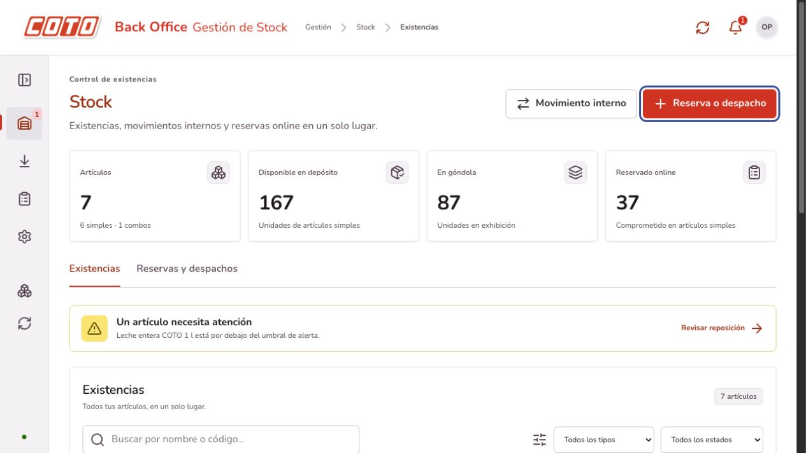
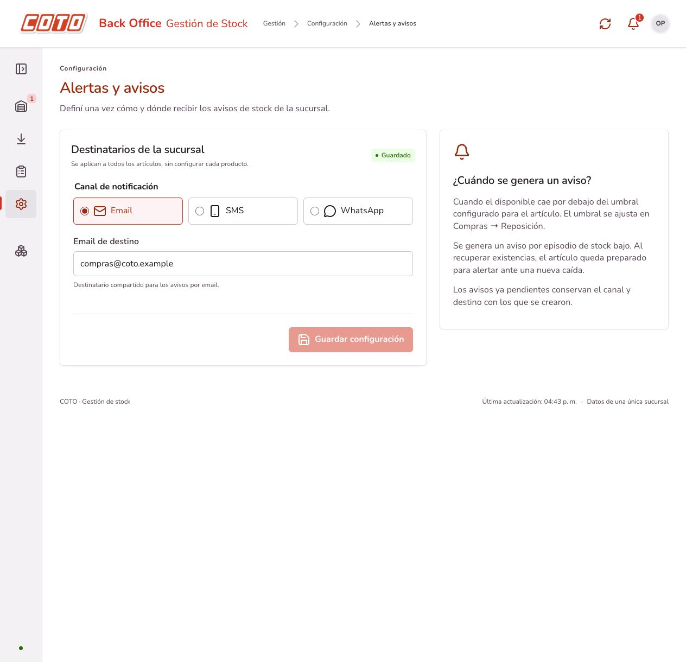

# Ajustes del backoffice — 16/10/2026

## Navegación y diseño

El encabezado ocupa todo el ancho, con el logo oficial de COTO, nombre del sistema, breadcrumb, actualización, notificaciones e información del operador. El sidebar se puede plegar a una columna de íconos o expandir con etiquetas. La preferencia se guarda en el navegador; en móvil funciona como menú superpuesto y se cierra al navegar o presionar Escape.

Las secciones principales son **Stock**, **Recepción**, **Compras** y **Configuración**. Stock reúne las existencias de sucursal y las operaciones digitales, con indicadores compartidos y dos pestañas: Existencias y Reservas y despachos. Sus botones permiten registrar movimientos internos o reservas/despachos desde la misma sección.

Se retiró la página de Integraciones, junto con su pestaña, acceso del sidebar y enlaces desde Stock y Configuración. La ruta anterior `#/compras/integraciones` redirige a Reposición.

Las rutas antiguas `#/sucursal` y `#/digital` siguen abriendo la sección correspondiente dentro de Stock. La recepción distingue el ingreso directo de mercadería sin pedido de la recepción de pedidos enviados.

## Avisos compartidos

Configuración → Alertas y avisos define el canal y el destinatario general de la sucursal. Los artículos pueden elegir un contacto y canal particulares; ver [Contactos y avisos](contactos-y-avisos.md). Email muestra únicamente el campo de correo de destino; SMS y WhatsApp muestran únicamente el teléfono. Los valores se conservan al alternar de canal. Los umbrales continúan siendo propios de cada artículo y se configuran en Compras → Reposición. Ya no hay un campo de destinatario en el formulario de cada producto.

La configuración se persiste en `configuracion_avisos`, a través del puerto `RepositorioAvisos`. El Strategy de notificaciones utiliza el canal resuelto para cada aviso. Se prioriza la asignación particular del artículo y, si no tiene, la configuración general. Al crear un evento en la outbox, se captura su canal y destino; cambiar la configuración no altera los avisos previamente pendientes.

Los proveedores continúan siendo simulados. La interfaz de uso diario omite aclaraciones sobre la simulación; los mensajes emitidos siguen disponibles mediante `GET /api/integraciones` para diagnóstico técnico.

API:

- `GET /api/configuracion/avisos`.
- `PUT /api/configuracion/avisos` con `{ "canal": "EMAIL", "email": "compras@coto.example", "telefono": "+541100000000" }`.
- Los endpoints previos `/api/notificaciones/canal` siguen funcionando sobre la misma configuración persistida.
- `destinoAlerta` en políticas se mantiene como campo legado opcional para compatibilidad; el envío utiliza el destinatario global.

## Imágenes de artículos

El alta de artículos simples y combos admite una imagen opcional PNG/JPEG de hasta 2 MB y 4096 × 4096 píxeles. El formulario muestra la vista previa y permite quitar el archivo antes de guardar. El backend valida formato, contenido real, dimensiones y tamaño; no admite SVG ni rutas proporcionadas por el navegador.

La imagen se incluye en la misma solicitud de alta, por lo que el producto, la composición del combo y los bytes se confirman o revierten juntos. Un archivo inválido o un componente inexistente no deja un producto incompleto. Los bytes se guardan en `imagen_producto`, separados de las consultas de existencias; `producto.imagen_version` contiene la huella SHA-256.

Los endpoints `POST /api/productos` y `POST /api/combos` admiten el campo opcional:

```json
{
  "imagen": {
    "tipo": "image/png",
    "contenido": "BASE64_DEL_ARCHIVO"
  }
}
```

La respuesta de producto agrega `imagenUrl`. `GET /api/productos/{id}/imagen` devuelve los bytes y el MIME correcto; devuelve 404 si no hay imagen. Las imágenes aparecen como miniaturas en existencias y en el detalle del artículo. La validación en memoria utiliza APIs estándar de Java y no agrega dependencias de Spring/JPA al dominio.

## Ejecutar y actualizar

Reiniciar el backend para cargar los nuevos endpoints y entidades:

```sh
mvn -f backend/pom.xml spring-boot:run
```

El perfil demo recrea su base H2 y los datos iniciales al reiniciar; la configuración y las imágenes agregadas en esa base temporal se pierden al detener el proceso, igual que el resto del inventario. PostgreSQL conserva los datos.

Para una base PostgreSQL existente de las versiones 0.2 a 0.4, aplicar una vez, antes de arrancar esta versión:

```sh
psql -v ON_ERROR_STOP=1 -1 -d coto_stock \
  -f backend/src/main/resources/db/upgrade-backoffice.sql
```

Si se parte de la v0.1, aplicar primero `upgrade-etapa2.sql` y después `upgrade-backoffice.sql`. Para una base nueva, `schema.sql` y `data.sql` ya incluyen las tablas y columnas nuevas. No se modificó ni reinició el servidor habitual de desarrollo durante la verificación.

El frontend mantiene los comandos `npm ci`, `npm run dev` y `npm run build` desde `frontend`.

## Validación

`mvn -f backend/pom.xml verify`: **153 pruebas aprobadas, sin fallos ni errores** (65 HTTP), JAR empaquetado con Java 26. `npm run build`: TypeScript y Vite completados correctamente.

La suite incluye pruebas HTTP de configuración persistente, destinatario compartido para dos artículos, conservación de canal/destino en eventos pendientes, configuraciones inválidas, alta/consulta de imagen, rechazo de contenido inválido y rollback de imágenes al fallar un combo. La migración desde v0.1 también se verifica con los dos scripts encadenados.

En navegador real se comprobó el sidebar expandido/plegado, la navegación de Stock, los controles del header y el panel de notificaciones. Se guardó la configuración y se recargó para verificarla; se creó un artículo con imagen y se comprobó la miniatura y el detalle tras recargar. Un archivo de texto fue rechazado por el selector de imagen. En 390 px se verificaron header, menú, configuración, Stock y formularios sin desbordamiento horizontal del documento.

Las pruebas de navegador usaron los puertos aislados 18080 y 5174. Las pruebas Java usan H2 compatible con PostgreSQL; no se ejecutaron contra un servidor PostgreSQL real.





## Verificación de los últimos ajustes

TypeScript y Vite compilaron correctamente. En el navegador se verificaron los tres canales, la conservación del correo al alternar, la ausencia de enlaces a Integraciones y la redirección de la ruta anterior a Reposición. Esta comprobación usó el frontend local existente sin guardar cambios de configuración.

Las categorías y la herencia de destinatarios se describen en [Categorías de productos](categorias.md). La base PostgreSQL actualizada requiere también `upgrade-categorias.sql`.
