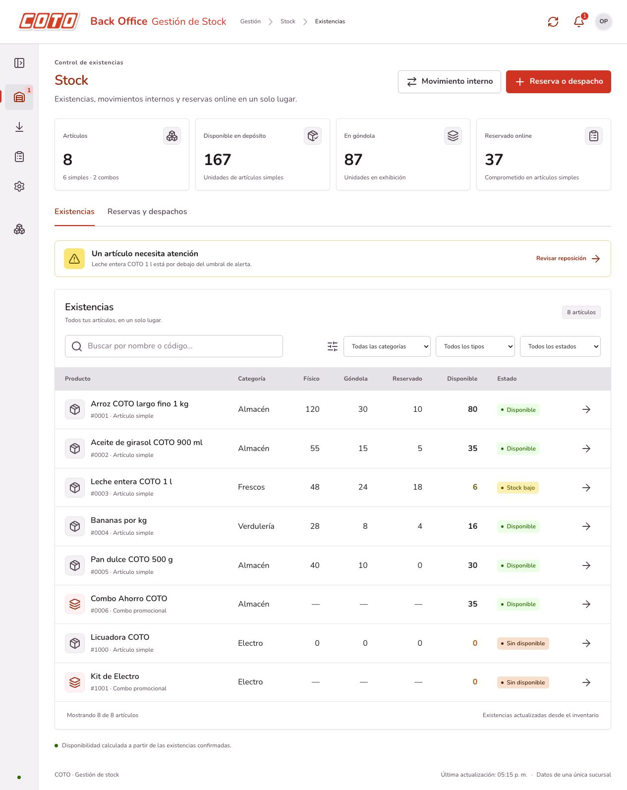
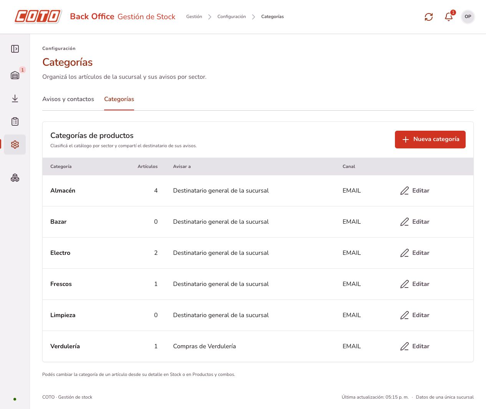

# Categorías de productos

## Uso

- **Configuración → Categorías** permite crear y editar categorías. Se incluyen Almacén, Frescos, Verdulería, Electro y Limpieza.
- Al crear un artículo simple o combo, elegir su **Categoría**. Puede quedar sin categoría.
- Para clasificar un producto existente, abrir su detalle desde Stock o Productos y combos, elegir **Categoría del artículo** y guardar.
- **Stock → Existencias** muestra la categoría y permite filtrarla, combinando categoría, tipo, estado y búsqueda. Reservas y despachos también permite filtrar por categoría.

La categoría es independiente del tipo SIMPLE/COMBO. Un combo conserva su propia clasificación sin modificar la de sus componentes. Reclasificar un artículo no modifica sus cantidades ni genera movimientos o auditorías de stock.

## Destinatarios por categoría

En Configuración → Categorías → Editar se puede elegir un contacto de la agenda y un canal. Se habilitan sólo los canales para los que el contacto tiene email o teléfono. Los umbrales de alerta siguen siendo propios de cada artículo y requieren su política de reposición.

Prioridad del aviso:

1. Contacto y canal particulares del artículo, si se configuraron.
2. Contacto y canal de su categoría.
3. Destinatario y canal generales de la sucursal.

Por ejemplo, al configurar Compras de Verdulería para Verdulería, los artículos de esa categoría comparten el destinatario salvo los que tengan una selección particular. La tabla de políticas muestra el destinatario resuelto y su origen. La agenda muestra también las categorías asignadas al contacto.

Se conserva el destino capturado en la outbox: editar o cambiar una categoría no reescribe avisos pendientes. No se puede quitar un email o teléfono que esté utilizando una categoría sin cambiar antes su canal o contacto. Los envíos conservan los adaptadores simulados del proyecto.

## Modelo y API

`Categoria` es un modelo de dominio sin dependencias de Spring/JPA. El puerto `RepositorioCategorias`, su implementación JPA y `ServicioCategorias` validan nombres y destinos, con el mismo bloqueo del inventario para coordinar cambios. Los nombres son únicos sin distinguir mayúsculas/minúsculas y se guardan sin espacios en los extremos. No incluye borrado ni jerarquía de subcategorías.

`producto.categoria_id` es una FK opcional. `categoria` almacena el nombre, contacto, canal y versión. La categoría no modifica el cálculo del disponible ni el patrón Composite.

- `GET /api/categorias` y `GET /api/categorias/{id}`.
- `POST /api/categorias` con `{ "nombre": "Bazar", "contactoId": null, "canalAlerta": null }`: devuelve 201 y Location.
- `PUT /api/categorias/{id}` con el mismo cuerpo: editar nombre o aviso.
- `POST /api/productos` y `POST /api/combos`: admiten `categoriaId` opcional, junto con imagen y demás datos. Las altas anteriores sin ese campo siguen funcionando.
- `PUT /api/productos/{id}/categoria` con `{ "categoriaId": 3 }` para asignar o `{ "categoriaId": null }` para quitar la clasificación.
- `GET /api/productos?categoriaId=3` permite combinar categoría y tipo.
- Los DTOs de producto devuelven `categoriaId`; el frontend resuelve el nombre desde la lista de categorías.

Las referencias inexistentes devuelven 404 antes de escribir. Un nombre duplicado o un canal sin datos de destino devuelve 400 y mantiene la configuración guardada.

## Actualizar la base

En demo, reiniciar el backend carga el esquema y los datos nuevos:

```sh
mvn -f backend/pom.xml spring-boot:run
```

La base H2 temporal se recrea al reiniciar. Los datos de demostración incluyen categorías asignadas a los seis productos de muestra.

En PostgreSQL con las migraciones de backoffice y contactos ya aplicadas, ejecutar una sola vez antes de iniciar la versión actual:

```sh
psql -v ON_ERROR_STOP=1 -1 -d coto_stock -f backend/src/main/resources/db/upgrade-categorias.sql
```

La migración conserva productos, stock, contactos, asignaciones particulares y avisos pendientes. Crea las cinco categorías iniciales y deja los productos existentes **sin categoría**, para asignarlos desde su detalle sin adivinar su clasificación.

Desde v0.1, el orden completo es `upgrade-etapa2.sql`, `upgrade-backoffice.sql`, `upgrade-proveedores.sql`, `upgrade-categorias.sql`. En una instalación nueva se utilizan directamente `schema.sql` y `data.sql`, sin migraciones.

## Validación

`mvn -f backend/pom.xml verify`: **153 pruebas aprobadas (65 HTTP), sin fallos ni errores**, con JAR empaquetado. Incluye filtro y clasificación de simples/combos, alta sin categoría compatible, referencias inválidas sin altas parciales, edición y nombres duplicados, reclasificación sin alterar stock/historial/componentes, prioridad de los tres destinos, protección de contactos usados por categorías y conservación de avisos pendientes. Se verifica la cadena de migraciones desde v0.1 con H2 en modo PostgreSQL; no se ejecutó contra PostgreSQL real.

`npm run build --prefix frontend`: TypeScript y Vite correctos. En el navegador se comprobó el filtro de ambos listados, cambio de categoría con persistencia al recargar, alta de un artículo y un combo en Electro, creación de Bazar, rechazo de nombre duplicado y selección del contacto de Verdulería. La prueba usó instancias aisladas en los puertos 18080 y 5174, sin modificar la instancia habitual de desarrollo.




