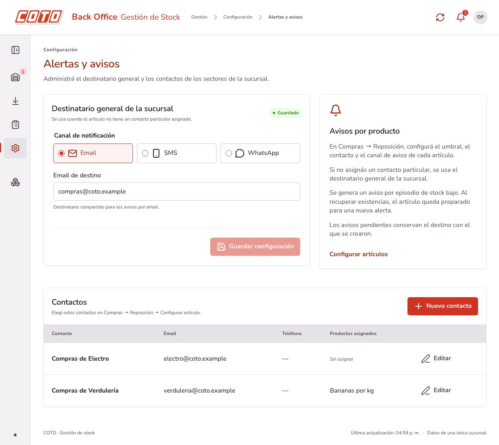
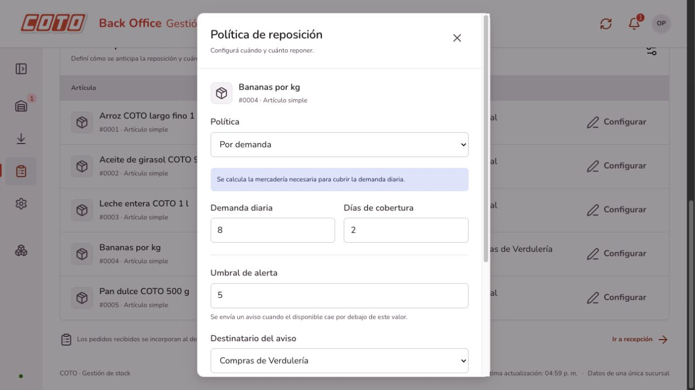

# Contactos internos y avisos por producto

## Uso

1. Abrir **Configuración → Alertas y avisos → Contactos**.
2. Crear un contacto con nombre y al menos un dato de contacto: email o teléfono. Se pueden cargar ambos y editar luego.
3. Ir a **Compras → Reposición → Políticas por artículo → Configurar**.
4. Definir el umbral de alerta, elegir el contacto como destinatario y seleccionar Email, SMS o WhatsApp. Sólo se habilitan canales para los que el contacto tiene datos.
5. Guardar la política. La tabla muestra el contacto y canal elegidos; la agenda muestra los productos asignados.

Por ejemplo, un electrodoméstico puede avisar a Compras de Electro y las bananas a Compras de Verdulería, cada uno con su email. El mismo contacto puede reutilizarse en varios artículos y con distintos canales. Estos son destinatarios internos; el abastecimiento de la sucursal se gestiona desde el centro de distribución de COTO.

Seleccionar **Destinatario general de la sucursal** elimina la asignación particular del artículo y vuelve al destino de su categoría o, si no tiene, al canal/destino general. La configuración general se mantiene como alternativa; no se envía una copia adicional allí cuando existe una asignación particular.

La agenda permite crear y editar contactos. No incluye borrado ni importación de archivos. Los avisos se generan por episodio de stock bajo; guardar una política no envía un mensaje inmediatamente. La nueva configuración se aplica en el siguiente movimiento o evaluación. Los envíos continúan usando los adaptadores simulados del proyecto.

## Persistencia y consistencia

`Contacto` representa un sector, equipo o responsable interno, con nombre y medios de aviso. Para conservar los datos ya guardados, el mapeo JPA mantiene los nombres físicos heredados `proveedor` y `politica_reposicion.proveedor_id`; la aplicación y el JSON usan `contactoId`. `canal_alerta` elige el canal particular; contacto y canal son nulos para la configuración general. Las políticas existentes conservan el comportamiento general al actualizar el esquema.

El dominio valida email, teléfono y correspondencia canal/destino. Un contacto sin email puede usarse para SMS/WhatsApp. No se puede quitar un dato que utiliza un artículo asignado: se debe cambiar primero su canal o destinatario. La edición del contacto y la asignación de políticas comparten el bloqueo de inventario para evitar dejar artículos sin destino durante cambios concurrentes.

`ServicioContactos` resuelve el destinatario al crear el evento en la outbox, priorizando artículo, categoría y destinatario general, en ese orden. La entrega y los reintentos utilizan ese snapshot: modificar el contacto, el canal del artículo o la configuración general no reescribe avisos pendientes. No cambia el cálculo de stock ni el envío de pedidos al ERP.

## API

- `GET /api/configuracion/contactos`: agenda ordenada por nombre.
- `POST /api/configuracion/contactos`: `{ "nombre": "Compras de Electro", "email": "electro@coto.example", "telefono": "" }`. Devuelve 201 y Location.
- `GET /api/configuracion/contactos/{id}`: contacto; 404 si no existe.
- `PUT /api/configuracion/contactos/{id}`: editar contacto con el mismo cuerpo.
- `PUT /api/productos/{id}/politica-reposicion`: admite `contactoId` y `canalAlerta` opcionales, además de los campos de reposición existentes. Deben estar ambos informados o ambos nulos. GET devuelve esa asignación.

La ruta anterior `/api/configuracion/proveedores` sigue disponible como alias de compatibilidad. Las solicitudes de políticas aceptan `proveedorId` como alias de entrada; las respuestas usan `contactoId`.

## Actualizar

El cambio de vocabulario no requiere otra migración ni cambia los IDs guardados. Para ese cambio de vocabulario, si ya se aplicó `upgrade-proveedores.sql`, basta con reiniciar el backend. La versión actual también incluye categorías y requiere su [migración adicional](categorias.md).

Reiniciar el backend para cargar las nuevas rutas y entidades:

```sh
mvn -f backend/pom.xml spring-boot:run
```

El perfil demo recrea la base temporal al reiniciar. En PostgreSQL existente, aplicar una vez antes de iniciar la nueva versión:

```sh
psql -v ON_ERROR_STOP=1 -1 -d coto_stock -f backend/src/main/resources/db/upgrade-proveedores.sql
```

Si todavía no se aplicó `upgrade-backoffice.sql`, ejecutarlo antes. Una instalación nueva usa directamente `schema.sql` y `data.sql`, sin scripts de actualización. Desde v0.1: `upgrade-etapa2.sql`, `upgrade-backoffice.sql` y `upgrade-proveedores.sql`, en ese orden.

## Validación

`mvn -f backend/pom.xml verify`: 153 pruebas aprobadas (65 HTTP), sin fallos ni errores. Incluye persistencia de contactos, avisos a dos contactos por canales diferentes, alternativa general, contactos inválidos, asignaciones incompletas/inexistentes, protección de datos de contacto en uso, vuelta al destinatario general y conservación de destinos en avisos pendientes. Se verifica también la cadena de migraciones desde v0.1 con H2 en modo PostgreSQL. No se ejecutó contra un servidor PostgreSQL real.

`npm run build --prefix frontend`: TypeScript y Vite correctos. En el navegador se crearon contactos de Compras de Electro y Compras de Verdulería, se asignó Verdulería a bananas y se comprobó la persistencia al recargar, la edición del contacto y las opciones deshabilitadas cuando falta el email o teléfono. Prueba aislada en puertos 18080 y 5174; no se guardaron datos de prueba en la instancia habitual de desarrollo.




