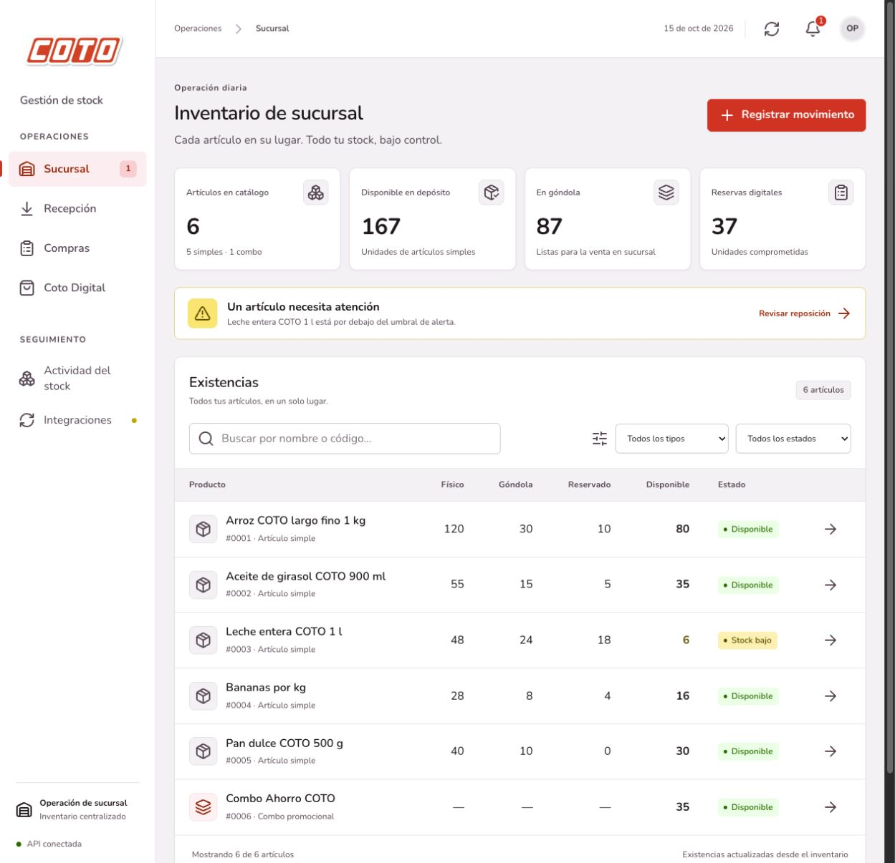

# Etapa 4 — Frontend React y Design System COTO

Aplicación React + TypeScript + Vite conectada a la API REST de la Etapa 3. La carpeta `frontend` es independiente del backend: no modifica el dominio Java ni vuelve a implementar sus reglas de stock, composición o precios.

## Ejecutar

Desde la raíz, en una terminal:

```sh
mvn -f backend/pom.xml spring-boot:run
```

En otra terminal, también desde la raíz:

```sh
cd frontend
npm ci
npm run dev
```

Requisitos: JDK 21–26, Maven 3.9+, Node.js 22.12+ y npm. Abrir <http://127.0.0.1:5173>. El backend inicia en 8080 y Vite reenvía `/api` a `http://127.0.0.1:8080`. Ambos procesos se detienen con Ctrl+C. H2 recrea los datos de demostración al reiniciar el backend.

Para otro puerto de backend, copiar `.env.example` a `.env.local` dentro de `frontend`, ajustar `API_PROXY_TARGET` y reiniciar Vite. Esta variable sólo configura el proxy local; no se incluye en el código del navegador.

```sh
# Desde frontend
npm run build
npm run preview
```

`build` verifica TypeScript y genera `dist`. `preview` sirve esa compilación en <http://127.0.0.1:4173> con el proxy hacia el backend. No se publicó en un servicio externo.

Si se sirve `dist` desde un servidor diferente, se debe reenviar `/api` al backend o definir `VITE_API_BASE_URL` antes de compilar. En el segundo caso, configurar los orígenes permitidos del backend mediante `coto.web.origenes`; los valores iniciales permiten localhost/127.0.0.1 en el puerto 5173. Las variables `VITE_*` son públicas y no deben contener secretos.

## Cuatro vistas operativas

| Vista | Funciones conectadas |
| --- | --- |
| Sucursal | Indicadores, búsqueda por nombre/código/descripción, filtros, detalle, traslado a góndola, retorno, devolución y mermas |
| Recepción | Ingreso de artículos simples, historial de ingresos y recepción confirmada de pedidos enviados |
| Compras y abastecimiento | Alta de productos y combos, composición con combos anidados, políticas de reposición, evaluación y seguimiento de pedidos, cancelación de pendientes, promociones acumulables y simulador de precios |
| Coto Digital | Catálogo valorizado según medio de pago, filtros, reservas con cantidad y cotización, cancelación y despacho |

Compras también incluye el historial de movimientos, la auditoría y el panel de integraciones. Este último permite seleccionar el canal de notificación, consultar mensajes/pedidos/sincronizaciones simulados, reintentar entregas y simular caídas de ERP, mensajería o Coto Digital en el perfil `demo`.

Las reservas del backend son cantidades agregadas por artículo: esta entrega no incorpora clientes, carrito, cobros ni identificación de pedidos web individuales. Los campos de operador registran la identificación declarada en la auditoría; no representan autenticación ni permisos por rol.

## Design System

`src/styles/tokens.css` contiene todos los colores exactos del pedido: Primary, Neutrals, Info, Success, Warning y Danger. La composición prioriza superficies blancas, fondos neutros y acentos rojos siguiendo la proporción visual 60/30/10.

La familia declarada es Gotham Rounded con Nunito, Montserrat y sans-serif como alternativas. Se distribuye Nunito Variable en el propio build, sin solicitudes a Google Fonts. Gotham Rounded se utiliza si está instalada; no se incluye una fuente comercial sin licencia.

Se definen Display 56/40/32 px, Heading 28/24/22/20 px, Body 18/16 px y Caption 12 px, con pesos bold, semibold, regular y book. Los títulos usan interlínea 140%. Las siete elevaciones van de `--shadow-100` a `--shadow-700`: cards en 100, modales en 300 y hover/active en 400.

La marca de navegación utiliza la imagen `src/assets/coto-superapp.png` proporcionada por el usuario, conservada sin modificaciones y con proporciones originales.

Los íconos pertenecen a `lucide-react`, con trazos outline y tamaños 24/32/48 px. La interfaz se adapta a escritorio y móvil, con navegación compacta, indicadores reorganizados, formularios de una columna y desplazamiento horizontal contenido en tablas y pestañas.

## Estado y contratos

- `api.ts` concentra HTTP y DTOs tipados; interpreta errores RFC 9457 y sus detalles de validación. Las solicitudes vencen a los 20 segundos y las lecturas obsoletas se cancelan.
- `store.tsx` consulta productos, pedidos, movimientos, auditoría, integraciones y políticas. Actualiza después de las operaciones y cada 20 segundos. No inventa existencias ni persiste stock en el navegador.
- La disponibilidad y los precios provienen del backend. Los combos muestran su composición y disponibilidad derivada, sin contadores propios.
- Durante una operación se bloquea el envío duplicado. Las mutaciones no se reintentan automáticamente: ante una respuesta incierta se indica revisar los movimientos antes de repetir.
- Si una operación se confirmó pero falla la lectura posterior, el aviso distingue ambos resultados. Si el backend deja de responder, se identifican los datos conservados como desactualizados y se ofrece reintentar.
- Los modales usan `dialog`, etiquetas accesibles, Escape, bloqueo de cierre durante el envío y restauración del foco. Los resultados y errores se anuncian mediante regiones accesibles.

## Validación realizada

La compilación `npm run build` terminó correctamente con TypeScript estricto y Vite. La validación funcional se hizo en un navegador real contra un backend demo aislado en el puerto 18080, sin alterar los datos de otro servidor.

| Recorrido | Resultado observado |
| --- | --- |
| Trasladar 5 arroces a góndola e ingresar 10 al depósito | Nuevos movimientos y existencias actualizadas en las vistas |
| Recibir el pedido inicial de 30 leches | Pedido recibido, ingreso registrado y disponible incrementado |
| Cambiar la política de arroz a demanda y evaluar reposición | Pedidos generados y enviados al ERP simulado |
| Crear un producto simple y una canasta con un combo como componente | Nuevos artículos visibles; disponibilidad del compuesto calculada por la API |
| Cotizar 3 arroces con débito | $2.891,70; al desactivar la promoción de pago, $3.402,00; al reactivarla, $2.891,70 |
| Crear un descuento de 12,5% para aceite | Promoción persistida y nueva valorización visible |
| Reservar 2 combos, cancelar 1 y despachar 1 | Componentes actualizados; despachar conserva el disponible al descontar físico y reservado |
| Intentar cancelar una reserva excesiva | Error de reserva insuficiente visible, sin confirmación falsa |
| Reservar con Coto Digital fuera de servicio | Reserva confirmada y entregas pendientes visibles |
| Restablecer el proveedor y reintentar | Tres entregas procesadas y cero pendientes |
| Navegar en escritorio y a 390 px | Vistas y modales utilizables, sin desbordamiento del documento |
| Detener el backend y actualizar | Aviso de desconexión, datos anteriores identificados y opción de reintentar |
| Cerrar un modal con Escape | Modal cerrado y foco devuelto al botón que lo abrió |

Esta etapa agrega verificación manual de navegador y compilación, sin una suite automatizada de frontend. Las 129 pruebas del backend y 37 solicitudes HTTP documentadas en la Etapa 3 corresponden a la validación previa de esa entrega; no se modificó código Java en esta etapa.

Las capturas muestran el logo proporcionado y los datos originales, luego de reiniciar el backend demo al terminar los recorridos. Una ejecución nueva del backend demo vuelve a esos datos originales.



[Ver captura móvil](screenshots/sucursal-mobile.jpg).
