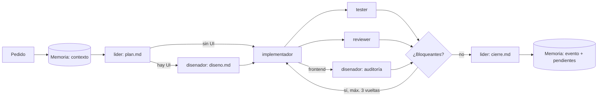

# Harness engineering: equipo de agentes

El repositorio incluye un *harness* para Claude Code: un equipo de cinco agentes especializados, un flujo que los coordina, artefactos de traspaso por pedido y una memoria SQLite compartida por los tres integrantes del grupo.

```text
.claude/
  agents/            lider · disenador-ux-ui · implementador · tester · reviewer
  skills/equipo/     /equipo <pedido>: orquestación completa
  memoria/           memoria.db (SQLite) + memoria.sql (espejo) + memoria.mjs (CLI)
  work/<slug>/       plan, diseño, implementación, pruebas, revisión y cierre de cada pedido
CLAUDE.md            reglas del proyecto que leen todos los agentes
```

## Roles

| Agente | Responsabilidad | Herramientas | Salida |
| --- | --- | --- | --- |
| `lider` | Alcance, criterios de aceptación, plan por agente, veredicto final | lectura + escritura de artefactos | `plan.md`, `cierre.md` |
| `disenador-ux-ui` | Flujo, pantallas y estados con el Design System COTO; auditoría de la UI | lectura + estilos y documentación del DS | `diseno.md` |
| `implementador` | Código de producción en backend y frontend; build en verde | edición completa | código, `implementacion.md` |
| `tester` | Pruebas de cada criterio, suites completas, evidencia | edición de pruebas | pruebas, `pruebas.md` |
| `reviewer` | Revisión independiente del diff; no edita | solo lectura | `revision.md` |

Cada agente tiene una responsabilidad y permisos acotados: el reviewer no puede editar, el tester no corrige producción, el líder no implementa. Así, quien escribe el código no es quien lo aprueba.

## Flujo `/equipo`



Los subagentes de Claude Code no pueden lanzar otros subagentes, por eso la sesión principal orquesta y el contexto viaja en archivos, no en conversaciones. Tester, reviewer y auditoría de diseño corren en paralelo.

## Memoria compartida

Cada integrante trabaja en su máquina con su propia IA. Sin una memoria común, cada IA arrancaría sin saber qué decidieron las otras. La memoria vive en `.claude/memoria/memoria.db`, una base SQLite **versionada**, con un espejo de texto `memoria.sql` que git combina con `merge=union`: si dos integrantes registran entradas en ramas distintas, el merge conserva las de ambos.

Todos los agentes leen `contexto` al empezar y registran decisiones, aprendizajes, pendientes y eventos al terminar. El uso de la CLI está en [.claude/memoria/README.md](../.claude/memoria/README.md).

## Uso

```sh
claude
> /equipo agregar alerta de vencimiento para lácteos en Stock
```

También se puede invocar un agente suelto: "usá el reviewer sobre el diff actual" o "pedile al disenador-ux-ui que audite Compras".
